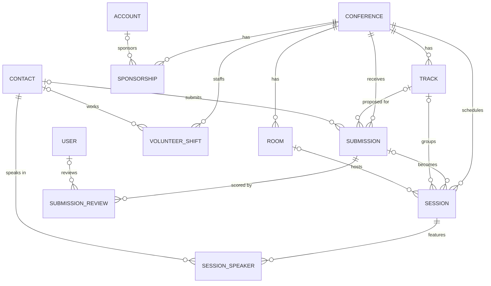

# Data model

## Relationship choices

- **Everything that belongs to one edition is a master-detail child of Conference.** Sharing follows the conference, and deleting a test conference cleans up its records.
- **Submission Review is a master-detail child of Submission.** That gives native roll-ups of review count and score total. The average score is a formula, because roll-up summaries can't average.
- **Session links back to its Submission by lookup.** Not every session comes from the call for papers: keynotes and breaks don't.
- **Speakers, volunteers and sponsors are standard Contacts and Accounts.** The same person can speak one year and volunteer the next without duplicate records.
